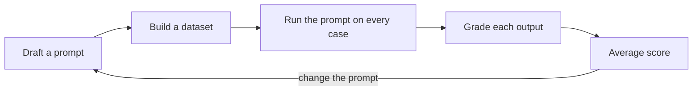

# 02 · Prompt evals

An eval is a repeatable test for a prompt. Instead of judging a prompt by
reading a couple of answers, you run it on a fixed set of inputs, score every
output and get one number. Then you can change the prompt and see whether the
number goes up.

## The workflow



| Step | File | What it does |
|---|---|---|
| 1. Prompt | [`prompt.py`](prompt.py) | Versioned prompt templates (`v1`, `v2`, ...) |
| 2. Dataset | [`generate_dataset.py`](generate_dataset.py) → `dataset.json` | Claude writes test cases with a task, a format and solution criteria |
| 3. Run + grade | [`run_eval.py`](run_eval.py), [`graders.py`](graders.py) | Runs every case, grades it, saves results to `results/` |

## The task being tested

A "data-cleaning helper" that must answer with **only** a Python function,
a JSON object or a regex. The strict output format means two kinds of grader
work together:

- **Code grader:** checks the output is valid (Python parses, JSON loads,
  regex compiles). It's fast, free and deterministic.
- **Model grader:** Claude scores the answer 1-10 against the case's
  criteria and explains why. It catches answers that are valid but wrong.

The final score per case is the average of the two.

## Run it

```bash
python 02-prompt-evals/generate_dataset.py --count 6   # optional: a sample dataset.json is included
python 02-prompt-evals/run_eval.py --version v1
python 02-prompt-evals/run_eval.py --version v2
```

## Results: v1 vs v2

| Prompt | What it says | Average score |
|---|---|---|
| `v1` | "Please solve the following task" | **3.17 / 10** |
| `v2` | Same task, plus explicit output rules: only the solution, no explanation, no code fences | **9.67 / 10** |

**v1:** every answer was *correct*. The model grader confirmed each one met
the solution criteria (6-7/10). But every answer was wrapped in markdown
fences, headings, tables and explanations, so the code grader gave 0 on all
three: `json.loads()` can't parse prose, and `re.compile()` can't compile a
markdown table. Without format instructions, Claude writes for a person
reading a chat, not for a program using the output.

**v2:** adding clear output-format rules to the prompt fixed it. One change
to the prompt, and the score tripled.

## What I learned

- **An eval is a repeatable test for a prompt.** Instead of reading a few
  answers and guessing, I run the prompt on a fixed dataset, score every
  output and get one number I can compare across prompt versions.
- **There are three ways to grade outputs, each with trade-offs:**

  | Grader | How it works | Good for | Downside |
  |---|---|---|---|
  | **Code** | Automated checks in code (does it parse? right length? contains X?) | Format and rules: fast, free, always gives the same result | Can't judge meaning or quality |
  | **Model** (LLM as judge) | Another Claude call scores the output against criteria | Correctness and quality: scales to many cases | Costs API calls; the grader can be lenient or inconsistent |
  | **Human** | A person reviews each output | The most reliable judgment, and for setting the standard | Slow and expensive, so it doesn't scale |

- **Combining graders tells you *why* a prompt fails.** In v1 the code grader
  said "unusable output" while the model grader said "correct content". That
  pointed straight at the problem: the prompt's instructions, not Claude's
  ability.
- **Be explicit about the output format.** A model can't guess that its
  answer will be fed to a program. If the output has to be machine-readable,
  the prompt has to say so.
- **Measure, change one thing, measure again.** Going from 3.17 to 9.67 is
  proof the change worked, not just a feeling that answers look better.
