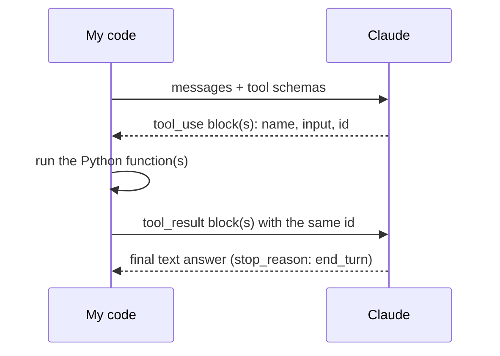

# 04 · Tool use

On its own, Claude can only write text from what it learned in training.
**Tools** let it do more: look up the date, run a calculation, save data,
search the web. Claude never runs a tool itself. It asks for a tool call, my
code runs it, and I send the result back.

## Project: a training log assistant

A terminal chat that logs workouts and answers questions about my training,
using four tools I wrote in [`tools.py`](tools.py):

| Tool | What it does |
|---|---|
| `get_current_datetime` | Today's date and weekday, so "this morning" or "this week" becomes a real date |
| `calculate_pace` | Pace (min/km) and speed (km/h) from distance and time |
| `log_workout` | Saves a workout to `training_log.json` |
| `get_training_summary` | Sessions, minutes and km per sport between two dates |

```bash
python 04-tool-use/assistant.py
```

Example of what happens on one message:

```text
you > I ran 10 km in 52 minutes this morning, felt strong. What was my pace?
  [tool] get_current_datetime({}) -> {"datetime": "2026-11-23T09:14", "weekday": "Monday"}
  [tool] calculate_pace({"distance_km": 10, "duration_minutes": 52}) -> {"pace_per_km": "5:12 min/km", "speed_kmh": 11.54}
  [tool] log_workout({"date": "2026-11-23", "sport": "running", ...}) -> {"saved": {...}, "total_workouts_logged": 1}

claude > Nice run! 5:12 min/km (11.5 km/h). I've logged it for today.
```
*(Example output. Yours will differ.)*

## How the tool loop works



The loop is in [`assistant.py`](assistant.py), written out by hand so every
step is visible:

1. **Tool functions:** plain Python functions that do the work.
2. **Tool schemas:** a name, a description and a JSON schema for the
   arguments. The description is what Claude reads to decide *when* to use a
   tool, so it matters as much as a prompt.
3. **Handling message blocks:** Claude's reply is a list of blocks (`text`,
   `tool_use`, and others). `stop_reason == "tool_use"` means it's waiting
   for tool results.
4. **Sending tool results:** each result goes in a `tool_result` block with
   the `tool_use_id` of the call it answers, inside a **user** message.
5. **Multiple turns and multiple tools:** the loop repeats until Claude stops
   asking for tools. One reply can contain several tool calls; all their
   results go back together in one message.

## Web search: a built-in server tool

[`web_search.py`](web_search.py) gives Claude internet access. Web search is
a **server tool**: Anthropic runs the searches, so I only add the tool to the
request. There's no function to write and no loop of my own. The answer
comes back with citations, and the script prints the sources.

```bash
python 04-tool-use/web_search.py "Who won the most recent Tour de France?"
```

Each search costs a small fee on top of tokens; `max_uses` limits the number
of searches per request.

## Text editor: Claude edits real files

[`notes_editor.py`](notes_editor.py) gives Claude the text editor tool
(`text_editor_20250728`), so it can create and edit markdown training notes.
Claude sends commands and my code runs them on disk:

| Command | What my code does |
|---|---|
| `view` | Shows a file with line numbers, or lists the folder |
| `create` | Writes a new file (saves a `.bak` of the old one first) |
| `str_replace` | Replaces text that matches exactly once, or returns an error |
| `insert` | Adds text after a given line |

```bash
python 04-tool-use/notes_editor.py
```

Example of an edit:

```text
you > In plan.md, change week 3's long run to 12 km
  [editor] {"command": "view", "path": "plan.md"} -> 1: # 4-week 10 km plan
  [editor] {"command": "str_replace", "path": "plan.md"} -> Edited plan.md

claude > Done: week 3's long run is now 12 km.
```
*(Example output. Yours will differ.)*

Paths come from the model, so every path is resolved and checked before any
file is opened. Anything outside `notes/` (`../`, absolute paths, symlinks
pointing out) is refused and sent back to Claude as an error.

