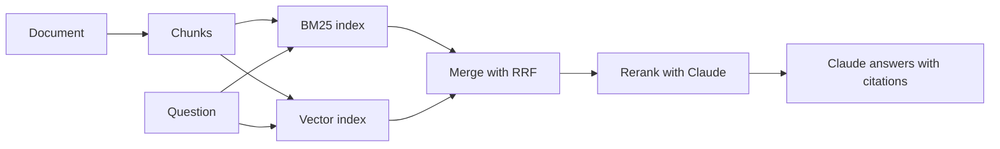

# 05 · Retrieval Augmented Generation (RAG)

Claude doesn't know what's inside my own documents, and sending a whole
library with every question is slow and expensive. **RAG** finds the few
pieces of a document that answer the question and sends only those, so
Claude answers from the real text and can cite it.

## Project: questions about a club training guide

[`training_guide.md`](training_guide.md) is a made-up running and cycling club
guide with nine sections: training zones, a workout library with codes like
`VO2-5x4`, fuelling, hydration, recovery, taper and club rules. It's test
material for the pipeline, not coaching advice.

```bash
python 05-rag/rag.py "How hard should my weekly long run be?"
python 05-rag/rag.py "What is VO2-5x4?" --compare      # BM25 vs vector vs hybrid
python 05-rag/rag.py "What should I eat on a 3 hour ride?" --contextual
python 05-rag/chunking.py                               # compare chunking strategies
```

## The pipeline



| Step | File | What it does |
|---|---|---|
| Chunking | [`chunking.py`](chunking.py) | Splits the guide by section, or by size with overlap, to compare them |
| Lexical search | [`bm25.py`](bm25.py) | BM25 written from scratch: finds exact words and codes |
| Semantic search | [`vector_store.py`](vector_store.py) | Voyage AI embeddings + cosine similarity: finds meaning |
| Hybrid search | [`retrieval.py`](retrieval.py) | Merges both rankings with reciprocal rank fusion |
| Reranking | [`retrieval.py`](retrieval.py) | Claude orders the candidates by relevance (structured output) |
| Contextual retrieval | [`retrieval.py`](retrieval.py) | Claude adds a sentence of context to each chunk before indexing |
| Answer | [`rag.py`](rag.py) | Claude answers only from the retrieved sections and cites them |

## Setup

Embeddings come from [Voyage AI](https://www.voyageai.com/), which needs its
own API key. Add it next to your Anthropic key in `.env` or `.env.local`:

```
VOYAGE_API_KEY=your-voyage-key
```

Each chunk is embedded once and cached in `.embeddings_cache.json`, and the
contexts are cached in `.context_cache.json`, so later runs only embed the
question. `--contextual` makes one Claude call per section the first time.
